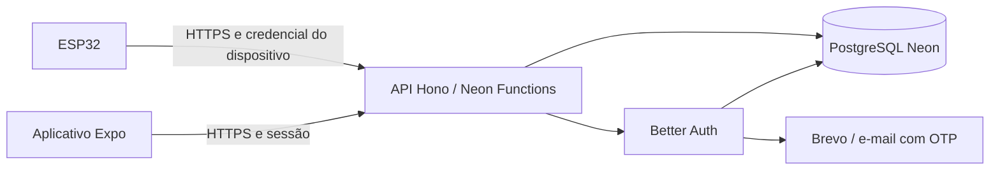

# APP-01 — Arquitetura, autenticação e hospedagem

Data da pesquisa: 13/10/2026.

Status: definição aceita para avançar à APP-02 em 14/10/2026. Existem apenas dados de teste no Firebase; recuperação por OTP de seis dígitos. Não houve instalação, criação de infraestrutura ou remoção do Firebase nesta tarefa. A validação executada das integrações pertence às tasks seguintes.

## Objetivo e contexto

Aplicativo Expo para acompanhar inicialmente uma lixeira na coordenação da faculdade, permitindo várias lixeiras por conta. O usuário consulta ocupação, necessidade de coleta, última comunicação e bateria quando disponível. O sensor atualizará o nível após esvaziamento; não haverá apontamento manual de coleta nem gestão de equipes no MVP.

O usuário decidiu retirar o Firebase e prefere iniciar sem mensalidade. O uso pretendido é real e contínuo. A arquitetura deve explicitar o custo potencial dessa operação, sem prometer que planos gratuitos a comportam indefinidamente.

Escopo funcional: [arquitetura-inicial.md](./arquitetura-inicial.md).

## Recomendação

| Camada | Escolha proposta | Motivo |
| --- | --- | --- |
| Aplicativo | React Native, Expo e TypeScript existentes | Preserva interface, validações e organização já iniciadas |
| API | Hono com TypeScript em Node.js | Uma API pequena, organizada por módulos e compatível com handlers HTTP padrão |
| Autenticação | Better Auth executado pela própria API, com plugin Expo | Integração oficial para sessão nativa e web; permite configurar o comportamento necessário |
| Sessão nativa | Plugin Expo com SecureStore | Evita implementar manualmente persistência de cookies e tokens |
| Banco | PostgreSQL no Neon | Armazena contas, sessões, lixeiras e medições em um banco relacional |
| Acesso SQL | `pg` com pool; migrações SQL versionadas | Alinhado ao runtime persistente de Neon Functions; não exige ORM nesta etapa |
| Hospedagem inicial | Neon Functions, runtime Node.js 24 | API próxima do banco e menos provedores de infraestrutura |
| E-mail | Brevo para o piloto, sujeito à ativação e verificação do remetente | Alternativa pesquisada para envio de OTP sem domínio próprio; validar entrega antes do piloto |

Better Auth nesta proposta é a biblioteca hospedada na nossa API. Não é o serviço gerenciado de autenticação do Neon. Seremos responsáveis por configuração, atualizações e operação da biblioteca.

As escolhas têm suporte documental, mas a combinação exata com o Expo SDK 57 deste repositório ainda não foi executada. Fixar versões compatíveis e validar sessões em dispositivo físico faz parte da APP-05.

## Alternativas comparadas

| Alternativa | Benefício | Limitação e decisão |
| --- | --- | --- |
| Better Auth + Hono em Neon Functions | Plugin Expo configurável e infraestrutura concentrada | Recomendada para validar; confirmar região, disponibilidade e cotas na conta antes de criar recursos |
| Better Auth + API Node no Render + Neon | Servidor Node convencional e implantação independente do banco | Alternativa de hospedagem; Free suspende após 15 minutos sem tráfego e a retomada pode levar cerca de um minuto |
| Neon Managed Better Auth + API | Menor responsabilidade operacional sobre autenticação | Não selecionado agora: não foi comprovado nesta pesquisa o mesmo fluxo Expo nativo e a configuração dos plugins necessários no serviço gerenciado |

Cloudflare Workers Free foi considerado, mas seus 10 ms de CPU por requisição tornam arriscado escolher autenticação com hash de senha na mesma função sem medição prévia. Essa é uma avaliação de adequação, não uma afirmação de incompatibilidade geral.

Não usar um plano com restrição comercial como base de uma futura oferta comercial sem revisar seus termos. Nenhuma mudança para plano pago está autorizada por este documento.

## Componentes e fluxo



- Aplicativo: apresenta telas e consome contratos HTTP; não conhece SQL nem credenciais do banco.
- API: valida entrada, sessão e propriedade da lixeira; coordena regras e persistência.
- Better Auth: cadastro, senha, sessão, logout, verificação e recuperação. Não criar criptografia ou protocolo de sessão próprios.
- Banco: conserva identidade e estado; a API restringe as consultas à conta autenticada.
- ESP32: é um cliente distinto, com autenticação própria. Não recebe cookie do usuário nem acesso administrativo ao banco.
- E-mail: fica atrás de uma interface de envio, permitindo trocar o fornecedor sem modificar telas.

Organização futura, sem criar estas pastas nesta tarefa:

```text
mobile/                       aplicativo existente
api/
  src/
    auth/                     configuração Better Auth
    modules/accounts/         perfil e ciclo de vida da conta
    modules/bins/             propriedade e cadastro
    modules/telemetry/        recebimento e consulta de leituras
    db/                       pool e consultas
    email/                    integração de envio
    http/                     rotas, validação e erros
  migrations/                 alterações versionadas do banco
```

Separar ambiente de desenvolvimento do piloto; nunca executar testes destrutivos no banco de uso real.

## Autenticação e recuperação

1. Cadastro com nome, e-mail e senha pelo Better Auth; a API valida os campos.
2. Verificação de e-mail antes de vincular dispositivos no piloto, para reduzir contas com endereço incorreto.
3. No aplicativo nativo, usar o cliente oficial Expo e SecureStore. Na versão web, usar cookies e configuração de origem apropriada.
4. Requisições das lixeiras transportam a sessão conforme o cliente oficial. A API valida a sessão em cada operação protegida e obtém a identidade no servidor.
5. Logout encerra a sessão e limpa dados locais da conta; expiração leva de volta ao login.
6. Recuperação responde genericamente, sem revelar se o endereço está cadastrado. O plugin Email OTP do Better Auth gera um código numérico de seis dígitos e o serviço de e-mail o entrega. O canal proposto é o e-mail cadastrado, mantendo o login normal por e-mail e senha.
7. O usuário informa e-mail, recebe o código, digita o OTP e define uma nova senha no próprio aplicativo. Não é necessária uma página web de redefinição nem um deep link para concluir esse fluxo. Validar o código e alterar a senha no servidor; liberar uma tela no cliente não comprova autorização.
8. Redefinir a senha deve revogar as sessões anteriores. Testar esse comportamento no endpoint OTP da versão escolhida, sem presumir que todas as opções do fluxo por link se aplicam. Códigos, tokens, senhas e cookies não entram nos logs ou nas respostas da API.

Política proposta: código com validade de cinco minutos, uso único e no máximo cinco tentativas; reenvio após pelo menos 60 segundos, invalidando o código anterior. Aplicar limites adicionais de envio e validação por conta e origem no servidor; reenvio não pode zerar ilimitadamente a proteção contra tentativas. Usar armazenamento protegido do OTP oferecido pelo plugin, evitando texto puro. Estes limites são decisões de projeto e devem ser configurados e testados; não são afirmações sobre os valores padrão da biblioteca.

OTP substitui o link, não o serviço de envio. O usuário confirmou que não possui domínio. A Brevo documenta reescrita de remetentes gratuitos/não autenticados para `@brevosend.com` como medida temporária. Por isso é uma opção para validar o piloto, sem prometer entrega ou disponibilidade antes da ativação da conta. Para operação comercial, planejar domínio autenticado. Se a conta não permitir o envio, revisar o fornecedor antes de liberar recuperação real.

Definir origens permitidas explicitamente; curingas de desenvolvimento não entram no piloto. Proteger cadastro, login, recuperação e vinculação contra abuso. Como haverá várias instâncias possíveis, não confiar apenas em contadores na memória para limites de segurança.

A exclusão de conta deve revogar sessões e credenciais/vínculos conforme política definida antes da APP-06. Não reaproveitar a compensação entre Firestore e Firebase Auth como se fosse necessária no novo banco transacional.

Não enviar e-mail com uma promessa solta que possa ser interrompida ao encerrar a requisição. APP-06 deve definir execução garantida pelo runtime ou um mecanismo persistente de envio e repetição, sem revelar existência de conta por mensagens ou tempos facilmente distinguíveis.

## Contratos iniciais para orientar as próximas tasks

Estes são limites de responsabilidade, não uma API já implementada. APP-04 detalhará schemas de entrada, erros e respostas.

| Grupo | Contrato proposto | Acesso |
| --- | --- | --- |
| Autenticação | `/api/auth/*`, gerenciado por Better Auth | Regras do provedor por operação |
| Saúde | `GET /health`, sem consulta periódica ao banco | Público, sem dados internos |
| Perfil | `GET /v1/me`, `PATCH /v1/me` | Sessão válida |
| Conta | `DELETE /v1/me` | Sessão recente e confirmação; política de dispositivos definida |
| Lixeiras | `GET /v1/bins`, `GET /v1/bins/:id`, `PATCH /v1/bins/:id` | Sessão e propriedade |
| Vinculação | `POST /v1/bin-claims` | Sessão verificada e prova temporária de acesso ao dispositivo |
| Histórico | `GET /v1/bins/:id/measurements` | Sessão, propriedade e consulta limitada |
| Telemetria | `POST /v1/device/measurements` | Credencial individual do dispositivo |

Regras comuns:

- IDs opacos; não usar e-mail como chave de propriedade.
- Horários em UTC/ISO 8601, distinguindo horário medido de horário recebido.
- Ocupação válida entre 0 e 100; bateria ausente é `null`, não zero.
- Medições incluem identificador de evento para tratar reenvios sem duplicação.
- Evento antigo não substitui estado atual mais recente.
- Respostas de erro têm código estável, mensagem segura e identificador da requisição.
- Nenhuma rota aceita `ownerId` do cliente como prova de autorização.
- Prova de vinculação, validade e tratamento de dispositivo já registrado serão especificados na APP-08 antes da implementação.

## Hospedagem e limites consultados

Neon Functions documenta Node.js 24 e execução de aplicações Hono. A disponibilidade consultada inclui regiões AWS Ohio, N. Virginia, Frankfurt e Singapore. Proposta para o piloto: banco e API na mesma região disponível, inicialmente N. Virginia, sujeita à confirmação na conta e à medição de latência a partir da faculdade.

Usar `pg.Pool` e tratamento de desconexão ociosa recomendado pela plataforma. O bootstrap específico de hospedagem fica isolado do código dos módulos para permitir mudança para outro servidor Node.

| Serviço | Limites gratuitos consultados | Consequência |
| --- | --- | --- |
| Neon Postgres | 1 GB e 100 CU-horas por projeto/mês | Medir armazenamento e tempo ativo antes de assumir uso contínuo gratuito |
| Neon Functions | 1 milhão de invocações, 10 horas de capacidade ativa e 400 de espera por projeto no período do plano | Processamento da API tem orçamento próprio; banco gratuito não implica API ilimitada |
| Brevo | 300 envios de e-mail/dia no Free | Validar conta transacional e remetente; não enviar códigos já expirados após espera em fila |
| Render Free, alternativa | 750 horas de instância por workspace/mês; suspensão após inatividade | Considerar retomada lenta e outras cotas; não é garantia de serviço de produção |

Os limites são uma fotografia da consulta, não compromisso contratual. Conferir os planos no momento da implantação.

### Por que operação contínua pode ultrapassar o gratuito

Estimativa ilustrativa: um compute de 0,25 CU ativo 24 horas por dia por 30 dias consome `0,25 × 24 × 30 = 180 CU-horas`, acima de 100. Consultas e escritas frequentes podem impedir a suspensão por inatividade.

Uma lixeira transmitindo a cada minuto produz 43.200 envios em 30 dias; a cada 15 minutos, 2.880. Esses números não incluem consultas do aplicativo, login e repetição de requisições, e não determinam sozinhos o consumo de CPU.

Não reduzir silenciosamente a atualização apenas para caber em uma cota. O intervalo deve equilibrar o tempo aceitável para detectar necessidade de coleta e o orçamento. Envio por mudança relevante combinado com comunicação periódica será validado na integração. Vários dispositivos com envios desencontrados podem manter o banco ativo mesmo com intervalo individual maior.

O Resend foi descartado para o início por exigir domínio verificado. A alternativa Brevo não torna domínio desnecessário para sempre: um domínio autenticado é evolução recomendada para entrega e identidade comercial. Não cadastrar domínio, contratar plano ou ativar cobrança nesta etapa.

## Auditoria da base Firebase e condições de migração

Constatações locais:

- O `package.json` declara Expo SDK 57 e Firebase SDK 12; a declaração não comprova compatibilidade executada da nova stack.
- Existe `AccountGateway`, com telas e validações reaproveitáveis, mas a implementação atual depende de Firebase Auth e Firestore.
- O modo padrão do aplicativo é demonstrativo; o backend Firebase é opt-in.
- Os arquivos locais `.env.development` e `.env.production` foram verificados apenas quanto à presença de configuração Firebase; não foram encontrados valores preenchidos no padrão esperado. Valores de segredos não foram exibidos.
- Não foi consultado um console Firebase remoto. Ausência de configuração local não comprova ausência de contas ou dados na nuvem.

O usuário confirmou que existem apenas testes. Não há migração de contas reais no escopo: preparar um novo ambiente e contas de teste, validar as jornadas e remover a integração antiga apenas na APP-16, após as substituições. Esta confirmação não executa nem exige excluir recursos remotos do Firebase.

## Validação e aceite

Validação realizada nesta APP-01: leitura do código/configuração local, comparação de documentação oficial e cálculo de consumo exemplificativo. Não foram realizados login real com Better Auth, implantação em Neon Functions ou envio de e-mail.

Validação exigida nas tasks de implementação:

- APP-04: executar Hono, conexão ao banco, autenticação das rotas e isolamento entre contas.
- APP-05: cadastro, login, reinício do aplicativo, sessão expirada e logout em dispositivo físico com a versão real do Expo.
- APP-06: entrega do e-mail com OTP, expiração, uso único, reenvio, tentativas limitadas, conta inexistente, revogação de sessões e conclusão no aplicativo. Validar também quota e falha de envio sem expor códigos.
- APP-10: telemetria autenticada, reenvio, evento fora de ordem e isolamento entre dispositivos.
- APP-17: regressões e jornadas completas; APP-18: medição de latência e consumo no piloto real.

As condições de migração foram esclarecidas e há uma proposta de envio sem domínio para o piloto. Revisar a proposta atualizada antes de implementar. A ativação e entrega real de e-mail, assim como compatibilidade executada do Expo, pertencem às validações das tasks seguintes; não foram comprovadas pela pesquisa documental.

## Fontes oficiais

- [Better Auth com Expo](https://better-auth.com/docs/integrations/expo): integração nativa/web, SecureStore e sessões. O guia consultado usa SDK 55, portanto não substitui validação do SDK 57 deste projeto.
- [Better Auth com Hono](https://better-auth.com/docs/integrations/hono): integração do handler e sessão com a API.
- [Better Auth: e-mail e senha](https://better-auth.com/docs/authentication/email-password): recuperação e revogação de sessões.
- [Neon Functions](https://neon.com/docs/compute/functions/overview): runtime e regiões.
- [Neon Functions: início](https://neon.com/docs/compute/functions/get-started): Hono, pool PostgreSQL e implantação.
- [Limites de Functions](https://neon.com/docs/compute/functions/reference/runtime-limits).
- [Neon Managed Better Auth](https://neon.com/docs/auth/overview): alternativa gerenciada distinta da biblioteca.
- [Planos Neon](https://neon.com/pricing) e [computes](https://neon.com/docs/manage/computes): cotas e unidades de processamento.
- [Scale to zero](https://neon.com/docs/introduction/scale-to-zero): suspensão por inatividade.
- [Render Free](https://render.com/docs/free): cotas e retomada após suspensão.
- [Cloudflare Workers: limites](https://developers.cloudflare.com/workers/platform/limits/): limite de CPU usado na comparação.
- [Resend: preços](https://resend.com/pricing) e [domínios verificados](https://resend.com/docs/dashboard/domains/introduction): cota e requisito de domínio.
- [Better Auth Email OTP](https://better-auth.com/docs/plugins/email-otp): recuperação com código, configuração e validação no servidor.
- [Brevo: plano gratuito](https://help.brevo.com/hc/en-us/articles/208580669-FAQs-What-are-the-limits-of-the-Free-plan): cota diária e comportamento de fila.
- [Brevo: remetentes e domínio](https://help.brevo.com/hc/en-us/articles/16045394674066-Troubleshooting-Domain-authentication): reescrita temporária de remetentes gratuitos/não autenticados.
