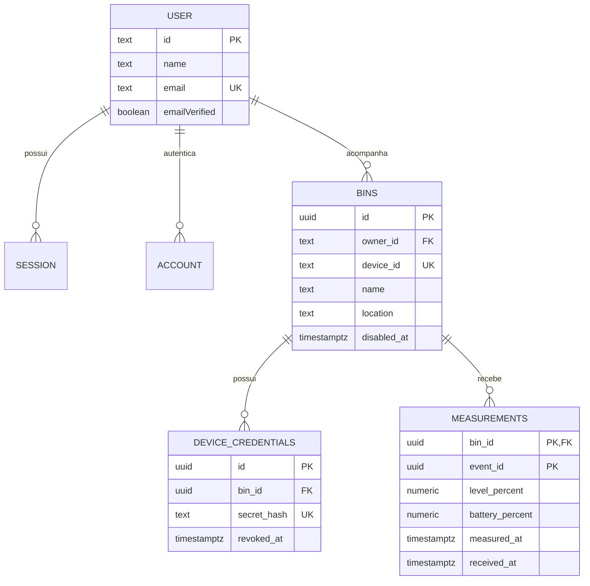

# APP-03 — Modelagem de dados PostgreSQL / Neon

Data: 14/10/2026. Escopo: schema inicial e migrações locais; implantação remota e autenticação executada pertencem às próximas tarefas.

## Modelo escolhido

Uma conta acompanha várias lixeiras; cada lixeira tem um proprietário. A identidade física permanece estável ao trocar nome ou Wi-Fi. Não há equipes, compartilhamento, rotas nem tabela de coletas: a ocupação muda por novas medições.

As quatro tabelas de autenticação seguem o core documentado do Better Auth. O schema `app` agrupa três tabelas de domínio e uma view de estado atual. Não duplicar perfil em outra tabela: nome e e-mail ficam em `public."user"`.



`verification` armazena verificações temporárias da autenticação e não tem FK de usuário: o identificador é definido pelo Better Auth. `bin_current_state` é uma view, não uma entidade persistida adicional.

## Dicionário e responsabilidades

| Tabela/view | Conteúdo | Responsável por escrever |
| --- | --- | --- |
| `public.user` | Identidade, nome, e-mail, verificação e timestamps | Better Auth e serviço de perfil autorizado |
| `public.session` | Sessões, validade e dados de cliente | Better Auth |
| `public.account` | Método de autenticação e hash de senha | Better Auth |
| `public.verification` | Valores temporários de verificação/OTP e validade | Plugin Email OTP |
| `app.bins` | UUID interno, ID físico, proprietário, nome, local e desativação | API autenticada |
| `app.device_credentials` | ID público da credencial, hash de segredo aleatório, criação/revogação | Provisionamento e rotação na API |
| `app.measurements` | Eventos de ocupação com bateria opcional e dois horários | API de telemetria após validar dispositivo |
| `app.bin_current_state` | Última leitura e última comunicação por lixeira | Consulta derivada, sem gravação direta |

### Identidade e propriedade

- IDs do Better Auth são `text`, compatíveis com sua geração padrão; a API não deve assumir UUID nesses campos.
- IDs internos das lixeiras/credenciais são UUID. `device_id` é único, diferencia maiúsculas/minúsculas e aceita de 3 a 64 caracteres alfanuméricos, hífen e sublinhado. Firmware deve enviar o mesmo formato estável em toda comunicação.
- `owner_id` é obrigatório; o cadastro persistido ocorre somente após comprovação de posse na APP-08. A preparação física antes do vínculo não cria uma lixeira sem dono nesta versão.
- Um usuário pode ter vários registros de lixeira; o mesmo `device_id` não pode ser cadastrado por duas contas.
- Trigger impede mudança de `id`, `device_id` e proprietário. Transferência de propriedade não entra no MVP; uma evolução precisará de política explícita e migração.
- Nome possui de 1 a 80 caracteres úteis; localização é opcional e limitada a 100. A API normaliza espaços e converte localização vazia em `null`.
- `updated_at` da lixeira é atualizado pelo banco. Timestamps da autenticação seguem a biblioteca.

### Credenciais e dados sensíveis

Armazenar SHA-256 hexadecimal de um segredo aleatório de pelo menos 32 bytes gerado no servidor; não usar esse mecanismo para senhas humanas. Entregar o segredo ao dispositivo apenas no provisionamento seguro; nunca listar hash/segredo nas respostas de lixeiras. O UUID da credencial identifica a chave e não prova acesso sozinho.

O banco permite apenas uma credencial não revogada por lixeira. Rotação revoga a anterior e cria a nova na mesma transação. Validar `disabled_at` e `revoked_at` em toda recepção. A regra de autenticação é da APP-04/APP-10, não é garantida apenas por FK.

Senha Wi-Fi não é armazenada no Neon. Senhas de conta são hashes gerenciados pelo Better Auth. O campo `verification.value` deve receber a representação protegida configurada no plugin; SQL não transforma automaticamente um código em hash nem aplica expiração/limite de tentativas.

### Medições e estado atual

- Chave primária composta `(bin_id, event_id)` impede duplicar evento da mesma lixeira. O ESP32 conserva o mesmo UUID ao reenviar; gerar outro UUID não é repetição idempotente.
- Ocupação é obrigatória e está entre 0 e 100, com até duas casas decimais. Bateria é `null` quando indisponível; não é inferida de conexão.
- Todos os horários são `timestamptz`; API envia e responde ISO 8601 em UTC. `received_at` vem do servidor e nunca deve ser aceito do payload do ESP32.
- `measured_at` não pode exceder recebimento em mais de cinco minutos. Essa tolerância é uma decisão inicial para desvio de relógio, validada na integração; não mede disponibilidade.
- Evento sem medição válida não é gravado como nível zero. Heartbeat sem leitura fica fora deste schema inicial; `last_seen_at` significa último recebimento de medição válida, e não qualquer pacote de rede.
- A view usa a medição com maior `measured_at`; desempata por recebimento e UUID do evento. Outra consulta indexada obtém o maior `received_at`.
- Leitura antiga recebida agora altera a informação de comunicação, mas não substitui o nível mais recente. Ambas as datas devem orientar os avisos de desatualização na APP-13.
- Sem eventos, a view retorna a lixeira com nível, bateria e horários nulos.

Alternativas avaliadas: uma tabela com cópia da última leitura exigiria manter dois registros sincronizados; calcular a leitura mais recente por varredura do histórico seria mais caro. A view com consultas laterais e índices atende ao piloto sem duplicação e pode evoluir se medições de desempenho justificarem.

## Índices e consultas

`bins(owner_id, created_at, id)` atende listagem por conta. `measurements(bin_id, measured_at DESC, received_at DESC, event_id DESC)` atende última leitura e histórico por período. Índices de recebimento atendem comunicação recente e retenção. Autenticação tem índices de identidade, sessão, e-mail normalizado e expiração.

Contrato de leitura da API (parâmetros preparados, nunca interpolação):

```sql
SELECT bin_id, name, location, level_percent, battery_percent,
       measured_at, received_at, last_seen_at, disabled_at
FROM app.bin_current_state
WHERE owner_id = $1
ORDER BY name, bin_id;
```

`$1` vem da sessão validada. Para detalhes/histórico, exigir também a propriedade, não apenas o UUID informado. A view não implementa autorização por usuário sozinha e não tem RLS. O schema não deve ser publicado por Data API nem acessado pelo app/ESP32. Uma role privada com permissões mínimas e consultas autorizadas será configurada na APP-04.

Histórico inicial: consulta dos últimos sete dias, paginação por cursor e limite máximo de 200 eventos por requisição, a implementar na API. Parâmetros configuráveis no servidor, sem novas tabelas para preferências nesta etapa.

## Retenção, exclusão e volume

Proposta inicial: conservar eventos detalhados por 90 dias desde o recebimento. A rotina deve preservar a última leitura e o último recebimento por lixeira, mesmo que antigos, para não transformar uma lixeira desconectada em uma lixeira sem histórico conhecido. Não criar agregações diárias nesta etapa.

A limpeza será implementada/agendada no backend, em lotes, na integração. O teste SQL exercita a condição de preservação. Limpar sessões/verificações expiradas respeitando o comportamento e o formato da versão fixada de Better Auth.

Excluir usuário com lixeiras é bloqueado por FK `RESTRICT`. A APP-06 deve oferecer política explícita para tratar os dispositivos e seus dados antes da exclusão; não perder histórico silenciosamente. A desativação normal marca `disabled_at` e revoga credenciais. Exclusão física de lixeira, se autorizada pelo serviço de conta, apaga medições/credenciais em cascata; não expor essa operação sem confirmação e política. Exclusão da conta sem lixeiras apaga sessões e métodos de acesso.

Com envio a cada 15 minutos, uma lixeira gera 8.640 eventos em 90 dias; a cada minuto, 129.600. Tamanho real inclui tabelas e índices: medir com `pg_total_relation_size`, sem prometer que caberá em uma franquia específica. Frequência de transmissão continua decisão da integração com o hardware.

## Migrações e verificação

Arquivos: `api/migrations/0001_auth.sql` e `0002_bins.sql`; instruções em [api/README.md](../../api/README.md). Migrações aplicadas em ordem em banco vazio, uma transação por arquivo. Sem `IF NOT EXISTS` para esconder schema divergente; controle automatizado de versão/checksum é responsabilidade da APP-04 antes de deploy automatizado.

O baseline de autenticação é manual, baseado no core documentado. APP-05 deve fixar versão/plugins, gerar o SQL oficial e comparar antes de ativar login. Não há tabela OTP própria nem alegação de autenticação já funcionando.

Testes locais em cluster PostgreSQL temporário: aplicar migrações do zero; verificar várias lixeiras por conta, inexistência de dono, ID físico duplicado, imutabilidade, ausência de leitura, valores inválidos, duplicação/reenvio, leitura fora de ordem, rotação de chave, retenção e exclusão referencial. Não testar contra banco remoto real.

Resultado em 14/10/2026: ambas as migrações aplicadas do zero no PostgreSQL 17 instalado localmente; suite SQL concluída com `PASS` e exit code 0. Cluster temporário encerrado ao final. Uma condição invertida na consulta de retenção do teste foi detectada e corrigida antes da execução final. Nenhuma infraestrutura Neon remota foi alterada.

## Referências

- [Better Auth: schema e migrações](https://better-auth.com/docs/concepts/database).
- [Better Auth: PostgreSQL](https://better-auth.com/docs/adapters/postgresql).
- [Better Auth: Email OTP](https://better-auth.com/docs/plugins/email-otp).
- [PostgreSQL: constraints](https://www.postgresql.org/docs/current/ddl-constraints.html).
- [PostgreSQL: inserções e conflitos](https://www.postgresql.org/docs/current/sql-insert.html).
