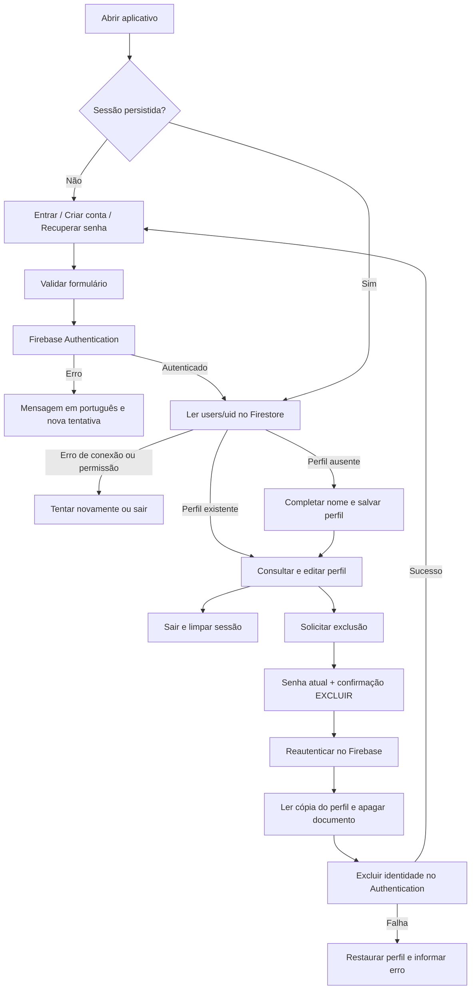

# Autenticação e CRUD de usuário

O aplicativo usa Firebase Authentication para identidade, senha, recuperação e sessão.
O Cloud Firestore armazena o perfil. Não existe autenticação simulada no aplicativo.

## Fluxo de negócio



| Operação | Regra |
| --- | --- |
| Criar | Nome de 2 a 80 caracteres, e-mail válido, senha de 8 a 128 caracteres e confirmação igual. A política configurada no Firebase também se aplica. |
| Consultar | Somente o usuário autenticado lê `users/{seuUid}`. Não há listagem pública de contas. |
| Atualizar | Editar nome preserva UID, e-mail e data de criação. E-mail é imutável nesta entrega. |
| Excluir | Solicita senha atual e texto EXCLUIR, reautentica, remove perfil e conta. |
| Login | E-mail normalizado; senha não é alterada nem submetida à política de criação. |
| Recuperar | Envia e-mail de recuperação com resposta genérica, sem confirmar existência de conta. |
| Sessão | Persistência nativa com AsyncStorage e web com armazenamento local do Firebase. Logout limpa a sessão. |

## Documento do perfil

```text
users/{uid}
  nome: string
  email: string
  createdAt: timestamp do servidor
  updatedAt: timestamp do servidor
```

Senha e confirmação existem apenas transitoriamente nos campos da interface e nas
chamadas ao Authentication. Nunca são gravadas no Firestore ou em logs do aplicativo.
Tokens de sessão são gerenciados pelo SDK. Cada assinatura de perfil é encerrada ao
mudar a sessão; dados de outra conta não são reaproveitados.

## Falhas parciais

Authentication e Firestore não compartilham uma transação. Se Authentication criar
a conta e o perfil falhar, o aplicativo mantém o acesso e mostra a conclusão do perfil.
Uma nova tentativa de login com a mesma conta também permite completar esse passo.

Na exclusão, reautenticação e leitura do perfil precedem qualquer remoção. Se o
Firestore negar a remoção, a identidade permanece. Se a remoção da identidade falhar,
o serviço tenta recriar o perfil. Se essa compensação também falhar, informa a
necessidade de recuperação: a conta ainda permite login e conclusão do perfil.
A recriação do documento gera novas datas de criação/atualização.

A operação de exclusão permanece vinculada ao UID que a iniciou, inclusive se
outra aba trocar a sessão. A remoção do documento usa transação para não deixar
uma exclusão em fila offline. Os testes de interface bloqueiam a requisição HTTP
da transação e verificam que o perfil permanece acessível após a reconexão.

Fechar o aplicativo entre as duas remoções pode deixar uma conta sem perfil; o próximo
login permite recuperá-la. Não há garantia de atomicidade entre serviços. Antes de
adicionar dados de lixeiras, será necessário definir exclusão/transferência de
propriedade e, se necessário, coordenação no backend.

## Arquivos principais

- `src/screens/auth/`: entrar, cadastrar, recuperar e gerenciar perfil.
- `src/contexts/AuthContext.tsx`: sessão, perfil observado, carregamento e trava de envio.
- `src/services/accountService.ts`: regras e coordenação do CRUD.
- `src/services/firebase/`: SDK, persistência, observadores e armazenamento.
- `src/utils/authValidation.ts`: validações reutilizáveis.
- `../firebase/firestore/firestore.rules`: autorização e validação dos documentos.

## Ativar no Firebase real

1. No console Firebase, crie ou selecione o projeto e registre um aplicativo Web para
   obter a configuração do SDK JavaScript usado pelo Expo.
2. Em Authentication, habilite o provedor **E-mail/senha**. Configure os modelos de
   recuperação de senha e a política de senhas. Habilite proteção contra enumeração.
3. Crie o Cloud Firestore. Use as regras do repositório; não deixe acesso aberto.
4. Preencha `mobile/.env.development` com os valores reais de `.env.example`.
   Para acesso real, `EXPO_PUBLIC_USE_FIREBASE_EMULATORS=false`.
5. Publique as regras no projeto correto (o comando abaixo publica somente Firestore):

   ```sh
   cd firebase
   npx firebase-tools login
   npx firebase-tools deploy --only firestore:rules --project SEU_PROJECT_ID
   ```

6. Reinicie o Expo com `cd mobile` e `npm start -- --clear`.
7. Cadastre uma conta de teste e confira Authentication e `users/{uid}` no console.
   Faça login, edite o nome, recupere a senha e exclua essa conta de teste.

Não compartilhe contas de serviço ou chaves privadas. A configuração `EXPO_PUBLIC_*`
integra o bundle e não é um cofre de segredos; a proteção dos perfis está no
Authentication e nas regras. Desenvolvimento e produção têm arquivos de ambiente
separados. As regras desta entrega bloqueiam todas as coleções além do perfil;
mescle regras existentes antes de publicar em um projeto que já tenha outros dados.

## Testes reproduzíveis

Em `mobile/`:

```sh
npm test
npm run typecheck
npm run lint
npm run test:emulators
npm run test:e2e
npx expo export --platform web
npx expo export --platform android --output-dir dist/android
```

Emuladores exigem Java 21+ e download inicial da CLI/componente Firestore. Os testes
usam exclusivamente o projeto `demo-lixeira-inteligente`. E2E inicia seu próprio
servidor Expo com configuração demo explícita, valida a interface com Chrome instalado
e captura imagens em `test-results/`. Para outro canal instalado, defina
`PLAYWRIGHT_CHANNEL=msedge`, por exemplo. Portas utilizadas: 8080, 8081 e 9099.

`npm test` cobre regras de negócio e falhas parciais com um adaptador de teste.
`test:emulators` exercita o adaptador Firebase real e as regras do Firestore.
`test:e2e` percorre as telas reais, incluindo recarregar a página com sessão ativa.
Compilar Android não substitui validar teclado e persistência em um aparelho físico.

## Executar manualmente com banco local

Para experimentar sem projeto em nuvem, use duas janelas do terminal. Na primeira:

```sh
cd firebase
npx firebase-tools emulators:start --project demo-lixeira-inteligente --only auth,firestore
```

Na configuração local do mobile, use os valores abaixo em desenvolvimento:

```dotenv
EXPO_PUBLIC_FIREBASE_API_KEY=demo-api-key
EXPO_PUBLIC_FIREBASE_AUTH_DOMAIN=demo-lixeira-inteligente.firebaseapp.com
EXPO_PUBLIC_FIREBASE_PROJECT_ID=demo-lixeira-inteligente
EXPO_PUBLIC_FIREBASE_APP_ID=demo-app-id
EXPO_PUBLIC_USE_FIREBASE_EMULATORS=true
EXPO_PUBLIC_FIREBASE_EMULATOR_HOST=127.0.0.1
```

Na segunda janela, rode `cd mobile` e `npm run web`. Os dados do emulador são
temporários e os links de recuperação aparecem no terminal; não há e-mail real.
Esse exemplo usa navegador no próprio computador. Para celular, é necessário
configurar o host de escuta dos emuladores e usar o IP do computador; não exponha
os emuladores fora de uma rede de desenvolvimento confiável.

## Verificação de dependências

Na implementação, `npm audit --omit=dev` reportou 29 alertas na árvore de dependências
(7 moderados, 21 altos e 1 crítico). O crítico é transitivo em `shell-quote`, usado
pela cadeia de ferramentas; Expo, React Native e Firebase também aparecem no relatório.
As sugestões automáticas incluem trocas incompatíveis de versão, portanto não foi
aplicado `npm audit fix --force`. A revisão/atualização dessas dependências permanece
pendente. Isso é separado dos testes funcionais de autenticação.

## Referências técnicas

- [Gerenciar usuários no Firebase](https://firebase.google.com/docs/auth/web/manage-users)
- [Persistência de autenticação](https://firebase.google.com/docs/auth/web/auth-state-persistence)
- [Referência de Authentication e persistência React Native](https://firebase.google.com/docs/reference/js/auth)
- [Regras de segurança do Firestore](https://firebase.google.com/docs/firestore/security/get-started)
